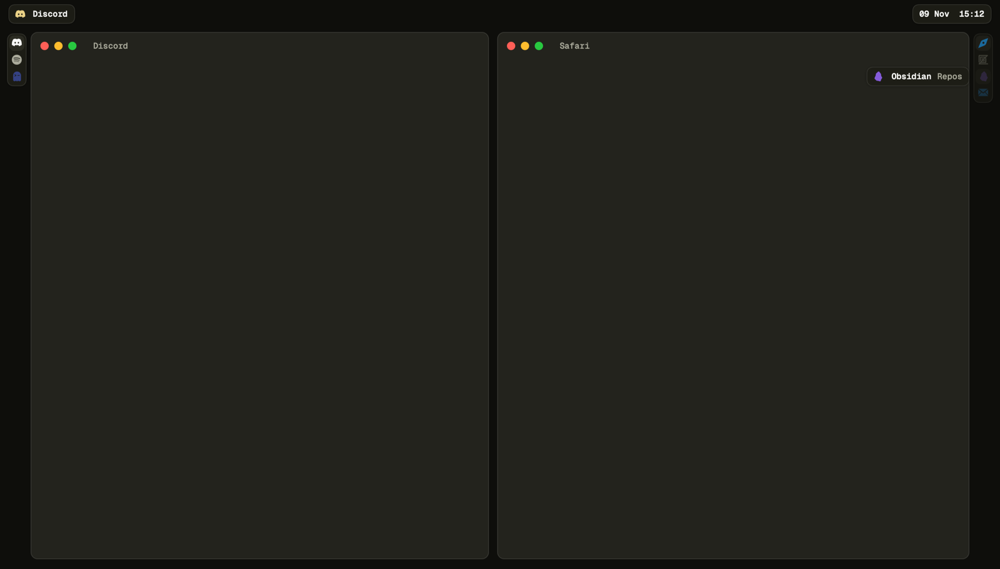

<div align="center">


# paw

**A tiling window manager for macOS, with stacks you can see.**

bsp and stack layouts, virtual workspaces, presets, key bindings and a CLI in one native app.<br>
No yabai, no skhd, no Hammerspoon, no SIP changes. Pure Swift and AppKit.

[](https://github.com/pseudobun/paw/actions/workflows/ci.yml)
[](https://github.com/pseudobun/paw/releases)
[](#requirements)
[](Package.swift)
[](LICENSE)

[Install](#install) · [Features](#features) · [Configure](#configure) · [Commands](#commands) · [Status bar](#status-bar) · [Development](#development)

<br>



<sub>Two tiles in bsp, each a stack. The islands beside them show every window in the stack.</sub>

</div>

> [!NOTE]
> paw is in **beta**. It runs as a daily driver, but config keys and commands may still change
> before 1.0. Read the [changelog](CHANGELOG.md) when you upgrade.

## Install

<table>
<tr>
<td width="56" align="center"><b>1</b></td>
<td>

**Install with Homebrew**

```sh
brew install --cask pseudobun/tap/paw
```

This puts `paw.app` in `/Applications` and the `paw` CLI on your `PATH`. Always use the full
`pseudobun/tap/paw` name: a bare `paw` cask in Homebrew is a different app.

</td>
</tr>
<tr>
<td align="center"><b>2</b></td>
<td>

**Stop other window managers**

Quit anything else that moves windows or grabs hotkeys, so they don't fight paw:

```sh
yabai --stop-service; skhd --stop-service   # if you use them
```

Also quit AeroSpace, Amethyst, Rectangle and the like.

</td>
</tr>
<tr>
<td align="center"><b>3</b></td>
<td>

**Start paw and allow Accessibility**

```sh
open -a paw
```

Then **System Settings → Privacy & Security → Accessibility → paw**. paw waits for the grant and
starts tiling right after.

</td>
</tr>
<tr>
<td align="center"><b>4</b></td>
<td>

**Tune macOS for tiling**

In **System Settings → Desktop & Dock**:

- turn off *Automatically rearrange Spaces based on most recent use*
- under *Windows*, turn off *Drag windows to screen edges to tile* and *Hold ⌥ key while dragging
  windows to tile*

Keep one native Space per display; paw's workspaces replace Spaces.

</td>
</tr>
<tr>
<td align="center"><b>5</b></td>
<td>

**Check it works**

```sh
paw status     # trusted: yes, bindings: ok
```

Press `ctrl+←/→` to move focus, `hyper+w` for bsp, `hyper+tab` for the overview. Your config is at
`~/.config/paw/config.json5` and applies the moment you save it.

</td>
</tr>
</table>

**Start at login:** set `openAtLogin: true` in the config.<br>
**Updates:** paw checks once a day and offers new versions; menu bar → *Check for Updates…* or
`paw update` looks right away, `updates.automatic: true` installs them without asking, and
`updates.check: false` turns it off. Or `brew upgrade --cask pseudobun/tap/paw`.<br>
**Uninstall:** `brew uninstall --cask pseudobun/tap/paw` (add `--zap` to remove the config and state too).

Quitting paw (`paw quit`) brings every hidden window back on screen. After a crash, start paw
again (it remembers which workspace each window was on) or run `paw recover`.

<details>
<summary><b>Build from source instead</b></summary>

<br>

Needs Xcode or the Command Line Tools (Swift 6) and [`just`](https://github.com/casey/just).

```sh
git clone https://github.com/pseudobun/paw.git && cd paw
just local-cert   # once: a self-signed certificate, so Accessibility survives rebuilds
just install      # → /Applications/paw.app, CLI → /opt/homebrew/bin/paw, then starts paw
```

If you have an Apple Development or Developer ID certificate, `just install` signs with it
instead of the self-signed one (or set `PAW_SIGN_IDENTITY`). Without either it signs ad hoc,
and macOS asks for Accessibility again after every rebuild.

`just launchd` starts paw at login with a LaunchAgent that restarts it after a crash.
`just uninstall` removes it all.

</details>

## Requirements

- macOS 14 Sonoma or later. Release builds are universal; paw is developed and tested on Apple
  Silicon
- The **Accessibility** permission
- Optional: the **Screen Recording** permission, for live window pictures in the overview
  (`overview.thumbnails`)
- Optional: [sketchybar-app-font](https://github.com/kvndrsslr/sketchybar-app-font) in
  `~/Library/Fonts` for app glyphs in the indicators (without it they show the app's own icon),
  and a Nerd Font such as `brew install --cask font-geist-mono-nerd-font` for their text
- Optional: something that turns Caps Lock into a **hyper key** (⌘⌃⌥⇧), e.g.
  [Karabiner-Elements](https://karabiner-elements.pqrs.org) or [Hyperkey](https://hyperkey.app),
  since several default bindings use `hyper`. Rebind them if you don't have one

## Features

<table>
<tr>
<td width="50%" valign="top">

### Tiling
Layouts per workspace: `bsp`, `columns`, `master`, `stack` and `float`. A weighted tree lets a
split hold any number of tiles, each with its share, so thirds come naturally. A tile that
closes gives its space to its neighbour.

</td>
<td width="50%" valign="top">

### Stacks you can see
Any tile can hold several windows. An island beside each stack shows one icon per window in the
app's own colour. Click to focus, scroll to cycle, hover for the title.

</td>
</tr>
<tr>
<td valign="top">

### Virtual workspaces
Like AeroSpace: instant switching with no Mission Control and no SIP changes. ⌘Tab to a window
on a hidden workspace switches to it.

</td>
<td valign="top">

### Presets and setups
Say which apps share which tile on which workspace. `initiate` opens them and arranges every
workspace in one go. Setups per display arrangement (laptop, home, office) apply by themselves.

</td>
</tr>
<tr>
<td valign="top">

### Mouse that helps
Drag a window and a preview shows where it lands: split, swap, stack (⌥) or dock. Drag the gap
between tiles to resize, double-click it to even out. Middle-button gestures switch workspaces.

</td>
<td valign="top">

### Overview
`hyper+tab` shows every workspace as a card and the selected one large, with live window
pictures. Type to filter, arrows to move, drag windows between workspaces.

</td>
</tr>
<tr>
<td valign="top">

### Built for scripts and bars
Every binding is also a CLI command (`paw focus west`, `paw workspace 3`).
`paw subscribe` streams JSON events over a private socket for sketchybar and friends.

</td>
<td valign="top">

### One config file
Commented JSON5 with every default, hot-reloaded on save. A broken file keeps the last good
config. The Settings window writes the same file, so people and agents can both edit it.

</td>
</tr>
</table>

<details>
<summary><b>Everything paw does</b></summary>

<br>

- **Layouts** per workspace: `bsp` (new windows split the focused tile, wide tiles side by side;
  see Canvas),
  `columns` (equal columns), `master` (one big window, the rest in rows beside it), `stack` (every
  window in one stack), `float`. Gaps, padding and optional room for a status bar (`layout.barTop`)
- **Weighted tree** (like TrellisWM): a split holds any number of tiles, each with its share, so
  thirds and rows of equal columns are natural; a tile that closes gives its space to its
  neighbour and the others keep their size
- **Stacks**: any tile can hold several windows. `stack <dir>` puts the focused window on the
  stack that way (merging stacks), `unstack` takes it out into its own tile, `unstack all` splits
  the whole stack; `focus stack.next|prev` goes through it, `swap stack.next|prev` reorders it
- **Moving**: `focus`, `swap`, `warp` in four directions (at the screen edge they go to the next
  display), `resize` (neighbours further along give way once one is at its minimum), `balance`,
  `rotate`, `toggle float|zoom|split`, `grid`
- **Drop zones**: drag a tiled window and a preview shows where it lands. On a tile's edge it
  splits that tile, on the gap between tiles it makes room there, at the screen's edge it docks
  beside everything, in a tile's middle it swaps (holding ⌥: stacks). Dropped on another display it
  joins the workspace there
- **Seams**: drag the gap between two tiles to resize both; double-click it to even them out.
  Dragging a tiled window's own edge resizes its tile too
- **Undo / redo** of layout changes per workspace (`hyper+z`, `hyper+y`), **focus history**
  across workspaces (`focus back|forward`, `hyper+o`/`hyper+i`) and **find** (`paw find safari`)
- **Canvas** (bsp, like TrellisWM; set `layout.minTileWidth`/`minTileHeight` to turn it on): tiles
  never get smaller than that. When there are more windows than fit, the tree grows
  past the screen and the screen shows the largest branch around the focused window; focus moving
  (keys, clicks, ⌘Tab) takes the screen with it. The overview shows the whole canvas with what's
  on screen outlined
- **Apps with a minimum size**: a window that won't shrink to its tile doesn't stick out over its
  neighbours; it waits out of sight and a placeholder with its icon and title takes the tile (click
  it to focus it, then move it with `ctrl+alt+arrows` or drag it somewhere roomier; double-click
  zooms in until it fits). Resizing stops before any tile gets smaller than
  `layout.placeholderMinWidth`/`Height`; `layout.placeholders: false` lets such windows stick out
  instead. `retile` forgets the learned sizes
- **Zoom through the tree** (TrellisWM's camera, one level at a time): `hyper+j` shows the branch
  holding the focused window over the whole workspace, again one level deeper down to the window
  alone; `hyper+k` steps back out, animated. ⌥-scroll or ⌥-pinch over a window does the same
  (`mouse.zoomModifier`). The rest waits out of sight
- **Overview** (`hyper+tab`): every workspace as a card, the selected one large with every window
  in its place (with Screen Recording: live pictures). Arrows move, typing filters, Return goes,
  ⇧Return brings the window to you, drag a window onto a card or next to another window
- **Windows come back**: a window you minimise, or whose app you hide or quit, returns to its
  tile; tiles, sizes and stacks survive restarting paw
- **Focus border** (`border`, off by default): a line around the focused window or placeholder,
  with its colour, width and radius in the config or Settings
- **Workspace HUD**: the number and apps of the workspace flash when you switch
- **Mouse gestures**: hold the middle (or back/forward) button and drag: left/right for the
  previous/next workspace, up for the overview
- **Mouse follows focus** (and optional focus follows mouse)
- **Virtual workspaces** (like AeroSpace): `layout.workspaces` exist from the start,
  `workspace new|close|next|prev|last`, `move-to <n> [--follow]`. A hidden workspace's windows
  wait in a screen corner, so switching is instant and needs no Mission Control or SIP. ⌘Tab to a
  window on a hidden workspace switches to it
- **Presets**: `workspaces` in the config says which apps share which tile on which workspace
  (narrowed by window `title` if you like); new windows of those apps land there, `arrange` puts
  everything back, `initiate` opens the apps (or runs a tile's `launch` command) and arranges every
  workspace in one go
- **Setups** per display arrangement (laptop only, home, work…): paw picks the one matching the
  connected displays by itself, pins each workspace to its display and numbers them display by
  display like yabai (`workspace new` on a display numbers it after that display's others).
  `paw initiate <setup>` (or the menu bar icon, or hop's "Set Workspace") forces one
- **Settings window** (menu bar icon → Settings…, or `paw settings`) for every key; it writes the
  same commented JSON5 file, so people and agents can keep editing the file too
- **Animations** for window moves: duration, curve (`easeOutCubic`, `spring`, `easeOutBack`…),
  and how sizes change
- **Stack indicators**: a vertical island next to each stack with one app icon per window, each
  in the app's own colour (picked from its app icon); click focuses, scroll cycles, hover shows
  the title
- **Modes**: `hyper+r` turns on resize mode (arrows or hjkl grow, with shift shrink, `esc`
  leaves) with an island at the top of the screen; define your own key modes in `modes`
- **Rules**: float or ignore apps and windows by name/title, send apps to workspaces
- **Key bindings** in the config (left/right modifiers like `ralt` work, `hyper` = ⌘⌃⌥⇧), and
  the same commands on the CLI: `paw focus west`, `paw workspace 3`
- **Events** for status bars and scripts: `paw subscribe` streams JSON lines (a snapshot first,
  then `workspaceChanged`, `windowFocused`, `windowsChanged`, `layoutChanged`, `modeChanged`,
  `displaysChanged`, `setupChanged`, `configReloaded`) over one connection, and `--exec` runs a
  command per event ([sketchybar example](examples/sketchybar/paw_spaces.lua)). Shell hooks still
  work
- **Private CLI socket**: the CLI talks to paw over a Unix socket only your user can reach

</details>

## Configure

On first launch paw writes `~/.config/paw/config.json5` (or `$PAW_CONFIG`) with every default and
a comment for each key; the same file is [`examples/config.json5`](examples/config.json5). Saving
applies it at once. A broken file keeps the last good config, and `paw config check` prints the
problem. Every key is optional: delete one to get its default.

A typical setup: presets for the apps you always use, a status bar, and a key to set it all up:

```json5
{
  layout: {
    workspaces: 7,
    barTop: 41, // with a 40 pt sketchybar
  },

  // Which apps go where. Apps in one tile stack, in this order (the first one on top).
  workspaces: {
    "1": { layout: "stack", tiles: [ { apps: ["Safari"] } ] },
    "2": { layout: "bsp", tiles: [ { apps: ["Ghostty"] }, { apps: ["Zed"], size: 1.5 } ] },
    // A tile for one window by title; `initiate` runs `launch` when it has no window yet.
    "4": { layout: "columns", tiles: [
      { apps: ["Ghostty"], title: "paw", launch: "open -na Ghostty --args --working-directory=$HOME/repos/paw" },
      { apps: ["Zed"] },
    ] },
    "3": { layout: "stack", tiles: [ { apps: ["Discord", "Spotify"] } ] },
    "6": { layout: "stack", tiles: [ { apps: ["Mail", "Calendar"] } ] },
    "9": { tiles: [ { apps: ["Slack"] } ], display: "secondary" },
  },

  // Per display arrangement; the first whose displays match replaces `workspaces` above.
  setups: {
    home: {
      displays: ["builtin", "DELL", "Gigabyte"], // "builtin", "external" or part of a display's name
      focus: "9",
      workspaces: {
        "1": { display: "builtin" },
        "8": { display: "DELL", layout: "stack", tiles: [ { apps: ["Discord", "Spotify"] } ] },
        "9": { display: "Gigabyte", layout: "bsp", tiles: [ { apps: ["Safari"], size: 2 }, { apps: ["Zed"] } ] },
      },
    },
  },

  // `paw initiate`: opens these apps (default: every app named in the presets), waits for their
  // windows and arranges every workspace, then shows `focus`.
  initiate: { apps: [], focus: "1", timeout: 15 },

  // For a bar, `paw subscribe` is sturdier (see Status bar); hooks still run shell commands.
  hooks: {
    displaysChanged: "~/.config/sketchybar/plugins/displays_changed.sh",
  },

  rules: [
    { app: "/^(System Settings|Calculator|Raycast)$/", float: true },
    { app: "Brave Browser", unlessTitle: "Brave", float: true }, // extension popups float
    { app: "Telegram", workspace: "5" },
  ],
}
```

Setting `bindings` or `rules` replaces the default list, so start from the ones in
`examples/config.json5` and change what you need.

| Section | Keys |
|---|---|
| `layout` | `default` (`stack`; also `bsp columns master float`), `minTileWidth` (0: off), `minTileHeight` (0), `placeholders` (true: a placeholder for windows that won't shrink to their tile; false: they stick out), `placeholderMinWidth` (160), `placeholderMinHeight` (120), `gap` (10), `padding {top bottom left right}` (2/2/24/24, widened on the sides to fit indicators), `barTop` (0), `barBottom` (0), `workspaces` (10), `unassignedWorkspace` ("": windows of apps no preset places stay put; or a workspace) |
| `focus` | `mouseFollowsFocus` (true), `focusFollowsMouse` (false), `wrapStacks` (false: stack next/prev stop at the ends), `wrapWorkspaces` (false: workspace next/prev stop at the first and last) |
| `animation` | `enabled` (true), `durationMs` (180), `curve` (`easeOutCubic`; also `linear easeInOutCubic easeOutQuint easeOutBack spring`), `resize` (`start` / `animate` / `end`), `maxWindows` (12) |
| `bindings` | `"key": "command"`; modifiers `cmd ctrl alt shift fn hyper meh` and `lalt/ralt lcmd/rcmd lctrl/rctrl lshift/rshift`, a key name or a keycode like `0x18` |
| `modes` | `"name": { "key": "command" }`; while `mode <name>` is on its keys come first. Default: `resize` |
| `workspaces` | `"name": { layout, axis, tiles: [{ apps: ["Discord", "Spotify"], size: 1, title?, launch? }, …], display: "builtin" }` |
| `setups` | `"name": { displays: ["builtin", "DELL"], focus, workspaces: { … } }` |
| `initiate` | `apps` ([] = every plain app name in the presets), `focus` (""), `timeout` (15 s) |
| `rules` | `{ app, title?, unlessTitle?, manage?, float?, workspace? }`; `app`/`title` are names or `/regex/` |
| `indicator` | `enabled` (true), `side` (`auto left right insideLeft insideRight`), `offsetX/Y`, `width`, `cellHeight`, `gap`, `padding`, `titles` (`hover`/`never`), `clickToFocus`, `scrollToCycle`, `unfocusedOpacity`, `fadeMs` |
| `appearance` | `font`, `fontSize`, `appFont`, `appIconSize`, `radius`, `cellRadius`, `borderWidth`, `shadow`, `colors {island islandHi border fg muted dim accent wave good bad}` |
| `icons` | `map` (a sketchybar `app_icons.lua`; paw has a built-in copy), `overrides` (`"App": ":glyph:"`), `brandColors` (true), `colors` (`"App": "#RRGGBB"`) |
| `hooks` | `workspaceChanged`, `windowFocused`, `windowsChanged`, `modeChanged`, `displaysChanged` (shell commands with `PAW_*` variables) |
| `mouse` | `dropZones` (true), `stackModifier` (`alt`), `seamHandles` (true), `gestures` (`[{ button: "middle", direction: "left", command: "workspace prev" }, …]`; buttons `middle back forward`, directions `left right up down click`) |
| `overview` | `thumbnails` (`auto`: when Screen Recording is allowed; `on` asks for it; `off`) |
| `hud` | `workspace` (true), `durationMs` (600) |
| `border` | `enabled` (false), `color` (`0xccead186`), `width` (2), `radius` (12), `offset` (2) |
| `updates` | `check` (true: look once a day and offer new versions), `automatic` (false: install without asking) |
| `openAtLogin` | |

App names are what macOS shows in the menu bar (`paw query` lists the open ones); `/regex/`
matches by pattern.

### Default bindings

| Keys | |
|---|---|
| `ctrl+←↑→↓` | focus |
| `ctrl+alt+←↑→↓` | swap |
| `ctrl+shift+←↑→↓` | stack onto the neighbour |
| `cmd+shift+ctrl+←↑→↓` | warp; a stacked window with nothing that way leaves its stack to that side |
| `hyper+←/→` | previous / next window in the stack |
| `ctrl+1…9`, `ralt+1…9` | workspace 1–9 |
| `ctrl+0`, `ralt+0` | the side workspace (`+N` in the bar) |
| `ralt+shift+1…0` | send the window to a workspace (0: the side workspace, to sort out later) |
| `cmd+ctrl+1…0` | send and follow |
| `ralt+a/d` | previous / next workspace |
| `hyper+n`, `hyper+d` | new / close workspace |
| `hyper+w/s/f` | layout bsp / stack / float |
| `shift+alt+wasd`, `shift+ctrl+wasd` | grow / shrink |
| `hyper+e`, `alt+r` | balance, rotate |
| `hyper+r` | resize mode: `←↑→↓`/`hjkl` grow, `shift+` shrink, `e` balance, `esc`/`return` done |
| `hyper+tab` | overview |
| `hyper+]`, `hyper+[` (đ, š on a Slovenian keyboard) | move the workspace one place right / left (on to the next display at the end); while hyper is held a strip shows its neighbours, a dashed `start` / `end` slot where the order stops, and the side workspace dimmed before the start |
| `hyper+j`, `hyper+k` | zoom in, out |
| `hyper+z`, `hyper+y` | undo, redo |
| `hyper+o`, `hyper+i` | focus back, forward (vim's jump list) |
| `ctrl+alt+return` | zoom |
| `ctrl+alt+space`, `ctrl+alt+c` | float, float in the middle |
| `ctrl+shift+return` | float full size |
| `ctrl+alt+u` | unstack |
| `cmd+alt+r` | recover |

### Several displays

When displays are unplugged, the workspaces that lived on them (pinned there by a setup, made there
with `workspace new`, or shown there) are cleared out: windows a preset in the new arrangement
places go to their preset workspace, every other window waits on the **side** workspace, which the
bar shows first as `+N` (N windows still to sort). Move them where you like; the side workspace
disappears once it's empty (when you're on it, you go back to where you were). Workspaces that only
existed for that display go away. `move-to side` (`ralt+shift+0`, with `--follow`: `cmd+ctrl+0`)
throws any window there when you don't know yet where it belongs; `workspace side` (`ctrl+0`) goes
there.

Each display shows one workspace. Without setups the workspaces are shared: switching shows one on
the focused display, or focuses the display that already shows it. With a setup, its presets pin
workspaces to displays (`display: "DELL"`), every bar shows only its display's workspaces, and
numbers run display by display. Plugging displays in or out switches setups and retiles
everything. `focus`/`swap` past the screen edge go to the next display, `display <dir>` and
`move-to-display` move between them.

### Status bar

`paw query --json` lists every workspace with its windows. `paw subscribe` tells a bar when to read
it again: one long-lived connection, a `snapshot` first, then one JSON line per event with a
`seq` that counts up (a gap means lines were lost):

```sh
paw subscribe workspaceChanged,windowsChanged
{"data":{"display":1,"prev":"2","workspace":"3","workspaces":[…]},"event":"workspaceChanged","seq":2,"ts":…}

# a command per event, with $PAW_EVENT, $PAW_SEQ and $PAW_DATA; waits for paw and reconnects
paw subscribe workspaceChanged,windowsChanged --reconnect --exec 'sketchybar --trigger paw_$PAW_EVENT'
```

[`examples/sketchybar/paw_spaces.lua`](examples/sketchybar/paw_spaces.lua) is a complete sketchybar
setup that starts that bridge itself.

### Overview

`hyper+tab` (or `paw overview`, or a middle-button drag up) covers every display: a search field,
the display's workspaces as cards (● on screen, gold the focused one), and the selected workspace
large with each window where it is. A stack shows its windows as icons; click one to go to it.

| | |
|---|---|
| `←↑→↓`, pointing | next window that way, on any display; past the edge ←→ go to the neighbouring workspace, ↑↓ to the previous / next one in number order (whatever display it is on) |
| `⇥` / `⇧⇥`, `1`–`9` | next / previous workspace, workspace N |
| typing, `⌫` | filter by app or title (the best match is selected), `esc` clears |
| `⏎`, click | go to the window (or the workspace) |
| `⇧⏎` | bring the window to the workspace you're on |
| drag a window | onto a card: send it there; onto the stage: drop zones as on the desktop (⌥ stacks) |
| drag on empty stage, ⇧-drag | pick a region: the screen then shows the smallest branch holding every window it touches |
| double-click a card, `+` | go to that workspace, new workspace |
| drag a card onto another card | the two workspaces trade contents (3 → 5) |
| drag a card to another display | move the whole workspace there |
| `⌘E` | switch between the stage and the canvas: every workspace of a display side by side, scrolled left / right; pinch, ⌘-scroll or `⌘-` / `⌘=` zoom |
| `esc`, right click | close |

With Screen Recording allowed (`overview.thumbnails`), windows show as pictures, otherwise as
their app's icon and colour.

## Commands

Bindings and the CLI take the same commands; chain several with `;`
(`paw 'workspace 3; layout bsp'`).

| Command | |
|---|---|
| `focus west\|east\|north\|south` | Focus the tile that way (next display at the edge) |
| `focus stack.next\|stack.prev\|stack.first\|stack.last` | Through the focused stack |
| `focus back\|forward` | Windows focused before (across workspaces) |
| `find <text>` | Go to the window whose app or title matches best |
| `swap <dir>` | Swap places with the window that way (to the next display at the edge) |
| `swap stack.next\|stack.prev` | Move the window down / up its stack |
| `warp <dir>` | Move into that tile's place, splitting it |
| `stack <dir>` | Put the window on the stack that way |
| `unstack [all]` | Take the window (every window) out of its stack |
| `layout bsp\|columns\|master\|stack\|float` | Layout of the focused workspace (again: re-tile) |
| `undo`, `redo` | The focused workspace's last layout change |
| `overview` | Every workspace and window (again: close) |
| `zoom in\|out` | Show the branch holding the focused window over the whole workspace (in: one level deeper), out: one level back up |
| `toggle float\|zoom\|split` | Float, fill the workspace, flip the split |
| `resize <dir> <points>` | Move that edge (negative shrinks) |
| `balance`, `rotate 90\|180\|270` | |
| `grid rows:cols:x:y:w:h` | Float the window into a grid cell |
| `workspace <n>\|next\|prev\|last\|new\|close` | Switch, add, close (its windows go to the previous one) |
| `move-to <n>\|next\|prev [--follow]` | Send the window to a workspace |
| `display <dir>\|next\|prev\|<n>` | Focus a display |
| `move-to-display <dir>\|<n> [--follow]` | Send the window to a display's workspace |
| `move-workspace next\|prev\|<n>` | Move the focused workspace's windows, tiles and layout to the next / previous workspace in the bar's order (past a display's last one: onto the next display) or to workspace N; the two trade contents and focus follows |
| `move-workspace-to-display <dir>\|next\|prev\|<n>` (or `move-workspace <dir>`) | Move the focused workspace, windows and all, to that display (it shows there; the display it left shows its next workspace) |
| `arrange [workspace\|all]` | Apply the preset(s), pulling their apps from other workspaces |
| `initiate [setup]` | Open the preset apps and arrange every workspace (also `reset`); with a setup, use that one |
| `mode <name>\|exit` | Turn a key mode on (again: off) or off |
| `retile`, `recover`, `reload` | |
| `exec <shell command>` | Run something (`exec open -a Terminal`) |

paw itself: `paw status`, `paw query [--json]`, `paw subscribe [events] [--reconnect] [--exec cmd]`, `paw setups [--json]`, `paw settings`,
`paw hide|show` (indicators), `paw update`, `paw reload`, `paw config path|check|show|template|format`,
`paw icon <app>`, `paw color <app>`, `paw preview out.png`, `paw quit`.

## Development

```sh
just build | test | preview | log
```

`Sources/PawCore` is pure logic and unit tested: the weighted layout tree (insert, remove, swap,
warp, stack, unstack, resize, seams, drops, anchors, snapshots, rotate, presets), drop zones, the
overview's geometry, neighbours, commands, key specs, easing, config.
`Sources/paw`: `WM/` (accessibility, tracking, animator, bindings, workspaces, mouse: drop preview,
seams, gestures), `Stacks/` and `UI/` (indicators, overview, HUD), `App/` (socket, events), `CLI/`. `just examples` regenerates `examples/config.json5` from the built-in
template. Manual checks: [TESTING.md](TESTING.md).

### Releasing

Releases come from [Conventional Commits](https://www.conventionalcommits.org) on `main`.
[release-please](https://github.com/googleapis/release-please) keeps a release PR open that
bumps [`VERSION`](VERSION) and writes [`CHANGELOG.md`](CHANGELOG.md): `fix:` bumps the beta
number, `feat:` too (until 1.0), `feat!:` the minor version. Merging that PR tags the version and
runs the [release workflow](.github/workflows/release.yml): tests, a universal `paw.app`, Developer
ID signing, notarization, the GitHub release, the Sparkle appcast (branch `appcast`) and the
cask in [`pseudobun/homebrew-tap`](https://github.com/pseudobun/homebrew-tap).

`just release [tag]` runs the release workflow by hand, e.g. to rebuild a tag.

## Contributing

Issues and pull requests are welcome. Run `just test` before you open one, and go through the
relevant parts of [TESTING.md](TESTING.md) for anything that touches windows. Commit messages
follow [Conventional Commits](https://www.conventionalcommits.org).

## Credits

App glyphs come from [sketchybar-app-font](https://github.com/kvndrsslr/sketchybar-app-font).
Ideas borrowed with thanks from [yabai](https://github.com/koekeishiya/yabai),
[AeroSpace](https://github.com/nikitabobko/AeroSpace) and TrellisWM.

## License

[MIT](LICENSE) © Urban Vidovič
